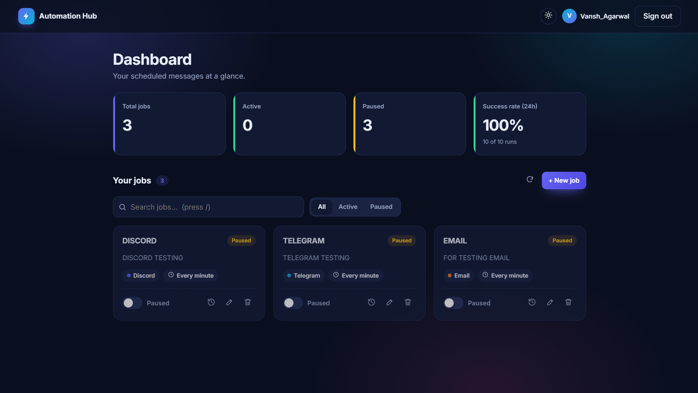
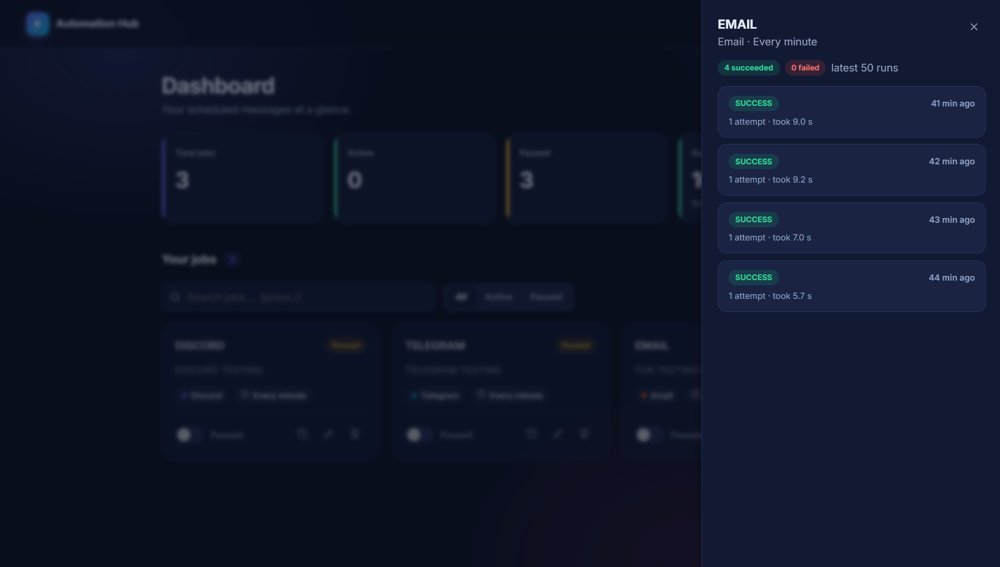
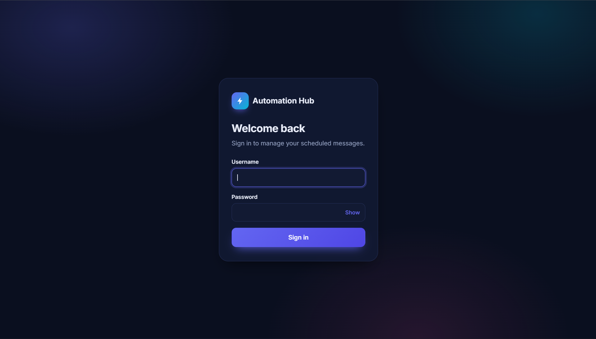

# Personal Automation Hub

A Spring Boot backend and web dashboard that sends scheduled messages to Telegram, Discord and Email.

## Overview
Personal Automation Hub lets me schedule recurring messages (reminders, daily goals, alerts) and
manage them from a browser. Each job has its own message, channel and cron schedule, stored in MySQL.
Creating, editing, pausing, resuming or deleting a job takes effect immediately, without restarting
the application.

What it does:
- **Dynamic scheduling:** every job has its own cron expression (IST), scheduled at runtime with Spring's `TaskScheduler`.
- **Multiple channels:** Telegram, Discord (webhook) and Email (SMTP), built with the Strategy pattern so a new channel is one new class.
- **Reliable delivery:** transient failures (network issues, rate limits, 5xx) are retried with exponential backoff; permanent failures (wrong token) are not retried.
- **Execution history:** every run is recorded with its status, number of attempts, duration and error reason.
- **Secured API and dashboard:** login with Spring Security (HTTP Basic, BCrypt), and a strict Content Security Policy.
- **Web dashboard:** plain HTML, CSS and JavaScript served by Spring Boot, with light and dark themes.

### Screenshots
| Dashboard (dark) | Run history |
|---|---|
|  |  |

| Login |
|---|
|  |

### Dashboard features
- Login screen (no browser popup) and sign out
- Stat cards: total, active and paused jobs, plus success rate of the last 24 hours
- Job cards with channel badge, human-readable schedule ("Every day at 8:00 AM") and status
- Pause / resume switch, edit and delete (with confirmation)
- New / edit job form with a **cron builder** (every day, weekdays, specific days, every N minutes or hours, custom cron) and a live preview
- Run history drawer with SUCCESS / FAILED badges, attempts and error messages
- Search, status filter, auto-refresh every 30 seconds
- Light / dark theme toggle, keyboard shortcuts (`/` to search, `n` for a new job), responsive layout

### Tech stack
Java 17, Spring Boot 4.1, Spring Web, Spring Data JPA (Hibernate), Spring Security, Spring Mail,
Bean Validation, MySQL 8, Maven, vanilla JavaScript, HTML and CSS.

### Project structure
```
src/main/java/com/vansh/automation_hub
├── channel/       MessageChannel interface, Telegram / Discord / Email channels, ChannelRegistry
├── config/        SecurityConfig, HttpClientConfig
├── controller/    JobController, ChannelController, StatsController
├── dto/           Request and response records
├── exception/     Custom exceptions and the global error handler
├── model/         Job, ExecutionLog, ExecutionStatus
├── repository/    Spring Data JPA repositories
├── scheduler/     SchedulerConfig, JobSchedulerService (dynamic scheduling)
└── service/       JobService, JobExecutionService, StatsService
src/main/resources/static   Dashboard: index.html, css/style.css, js/app.js, js/theme.js
```

## Concepts Covered
- Trigger -> Action model of automation
- Layered architecture: Controller -> Service -> Repository
- REST API design with proper HTTP methods and status codes (201, 204, 400, 401, 404)
- DTOs (Java records) to separate API contracts from database entities
- Bean Validation (`@Valid`, `@NotBlank`, `@Size`, `@Pattern`) and centralized error handling with `@RestControllerAdvice`
- Spring Data JPA, `JpaRepository`, derived queries (`findTop50ByJobIdOrderByStartedAtDesc`, `countByStartedAtAfter`) and `@Transactional` deletes
- Dynamic scheduling with `TaskScheduler`, `CronTrigger` and `ThreadPoolTaskScheduler`
- Tracking scheduled tasks with `ScheduledFuture` in a thread-safe `ConcurrentHashMap`
- Rebuilding schedules from the database on startup (`ApplicationReadyEvent`)
- Cron expressions (6 fields in Spring) with an explicit timezone (`Asia/Kolkata`)
- Strategy pattern: a `MessageChannel` interface and a registry that Spring fills with all implementations automatically
- Calling external APIs (Telegram Bot API, Discord webhooks) with `RestTemplate` and connect / read timeouts
- Sending email with Spring Mail (SMTP, Gmail App Password)
- Transient vs permanent failures, retries with exponential backoff, and a custom exception carrying a `retryable` flag
- At-least-once delivery and why retries can cause duplicate messages
- Spring Security: stateless HTTP Basic authentication, BCrypt password hashing, deny-by-default authorization
- Content Security Policy and other security headers
- Serving a static frontend from Spring Boot (same origin, so no CORS needed)
- Vanilla JavaScript SPA: `fetch` with an Authorization header, state management, safe DOM rendering (`textContent`, never `innerHTML` for user data) to prevent XSS
- Native `<dialog>` for modals and a side drawer, `sessionStorage` for the session, and `localStorage` for the theme preference
- Client-side plus server-side validation, and showing server field errors in the form
- Accessibility basics: aria labels, keyboard shortcuts, focus styles, reduced-motion support
- Externalized configuration: all secrets live in environment variables, never in the repository

## What I Learned
- How a bot token, chat id and webhook URL identify the sender and the receiver, and why they are secrets
- Why `@Scheduled` cannot change at runtime and how `TaskScheduler` solves it
- Why a job is re-read from the database when it fires, so edits apply immediately
- Why swallowing exceptions is dangerous, and why errors should be reported, not hidden
- Why a wrong token should never be retried, but a network timeout should
- How idempotency trade-offs differ between a reminder bot and a payment system
- How the Strategy pattern keeps code open for extension but closed for modification
- How to validate configuration at the API boundary instead of failing silently later
- How authentication works end to end: hashing, stateless requests, and why the API stays locked while static files stay public
- Why user-provided text must be rendered with `textContent`, and how a CSP adds a second line of defense
- Why a success rate should be rounded down, so 99.6% is never shown as 100%
- How to debug Maven, IDE, browser and API issues step by step

## How to Run
1. Prerequisites: Java 17+, Maven (or the included `mvnw`), MySQL 8, Git.
2. Create the database (tables are created automatically on first start):
   `CREATE DATABASE automation_hub;`
3. Create a Telegram bot with @BotFather, send `/start` to it, and find your chat id.
4. (Optional) Create a Discord webhook: Channel settings -> Integrations -> Webhooks.
5. (Optional) For Email, create a Gmail App Password (requires 2-Step Verification).
6. Set these environment variables:

| Variable | Required | Purpose |
|---|---|---|
| `TELEGRAM_BOT_TOKEN` | Yes | Telegram bot token |
| `TELEGRAM_CHAT_ID` | Yes | Telegram chat that receives messages |
| `DB_USERNAME` | Yes | MySQL username |
| `DB_PASSWORD` | Yes | MySQL password |
| `APP_USERNAME` | Yes | Dashboard / API login username |
| `APP_PASSWORD` | Yes | Dashboard / API login password (at least 12 characters) |
| `DISCORD_WEBHOOK_URL` | No | Enables the DISCORD channel |
| `MAIL_USERNAME` | No | Gmail address, enables the EMAIL channel |
| `MAIL_PASSWORD` | No | Gmail App Password, enables the EMAIL channel |

7. Start the application (set the environment variables in the same terminal first):
   - Windows (PowerShell): `$env:TELEGRAM_BOT_TOKEN="..."` (repeat for each variable), then `.\mvnw.cmd spring-boot:run`
   - macOS / Linux: `export TELEGRAM_BOT_TOKEN="..."` (repeat for each variable), then `./mvnw spring-boot:run`
   - Or run `AutomationHubApplication` from IntelliJ with the variables added in the run configuration.
8. Open `http://localhost:8080`, sign in, and click **+ New job**.
   A sample job is inserted on the first start.
9. Retry behaviour can be tuned with `retry.max-attempts` and `retry.initial-delay-ms` in `application.properties`.

Notes:
- The API has no HTTPS by default. Do not expose it to the internet without HTTPS, because the password is sent with every request.
- Timestamps in run history are stored without a timezone, so run the server in the same timezone as the browser (IST).

### API endpoints
All endpoints except the health check require authentication (HTTP Basic).

| Method | URL | Purpose |
|---|---|---|
| GET | `/actuator/health` | Health check (public) |
| POST | `/api/jobs` | Create a job |
| GET | `/api/jobs` | List all jobs |
| GET | `/api/jobs/{id}` | Get one job |
| PUT | `/api/jobs/{id}` | Update a job |
| DELETE | `/api/jobs/{id}` | Delete a job |
| PATCH | `/api/jobs/{id}/pause` | Pause a job |
| PATCH | `/api/jobs/{id}/resume` | Resume a job |
| GET | `/api/jobs/{id}/logs` | Latest 50 runs of a job |
| GET | `/api/channels` | Channels configured on this server |
| GET | `/api/stats` | Runs, successes and failures in the last 24 hours |

Example job body (cron format: second minute hour day month weekday, IST):

`{"name": "Study reminder", "message": "DSA time!", "channel": "TELEGRAM", "cronExpression": "0 0 21 * * *"}`

For `EMAIL` jobs, also send `"target": "someone@example.com"`.

## Possible Improvements
- Deploy with Docker on a cloud server (AWS or Google Cloud free tier) behind HTTPS
- Store timestamps as `Instant` (UTC) so history is correct in any server timezone
- A "Run now" button to test a job from the dashboard
- Schedule retries instead of sleeping in the scheduler thread, so threads are never blocked
- Retention policy to delete old execution logs
- JWT or OAuth login for multiple users, and rate limiting on the login endpoint
- More channels such as Slack or SMS, and per-channel message formatting
- Per-job timezone instead of a fixed IST
- Unit and integration tests (for example, retry logic with a fake channel, and MockMvc security tests)
- Database migrations with Flyway instead of `ddl-auto=update`